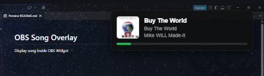

# OBS Song Overlay
Display song inside OBS Widget.  

# Usage
This program is Windows only as of version 1.0.0

### Prerequisites
* [NodeJS](https://nodejs.org/en/download) installed

### Steps
1. [Download](https://github.com/LimeGradient/OBS-Song-Overlay/archive/refs/heads/master.zip) and extract to your desired location
2. Install all required packages either by running `setup.bat` or opening a terminal window at this project and running `npm install`
3. Run the server either by running `start.bat` or opening a terminal window at this project and running `npm start`